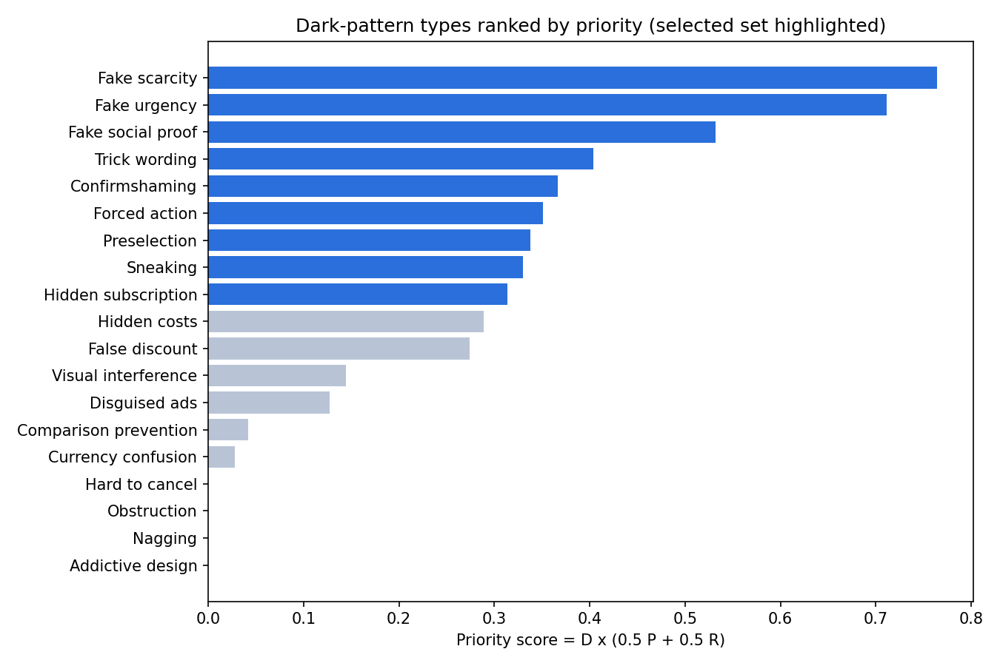
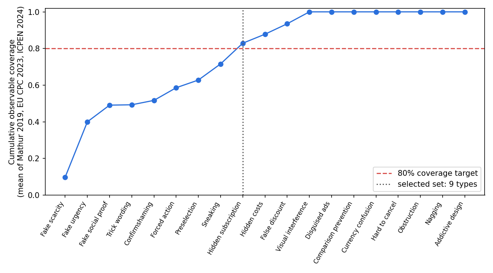
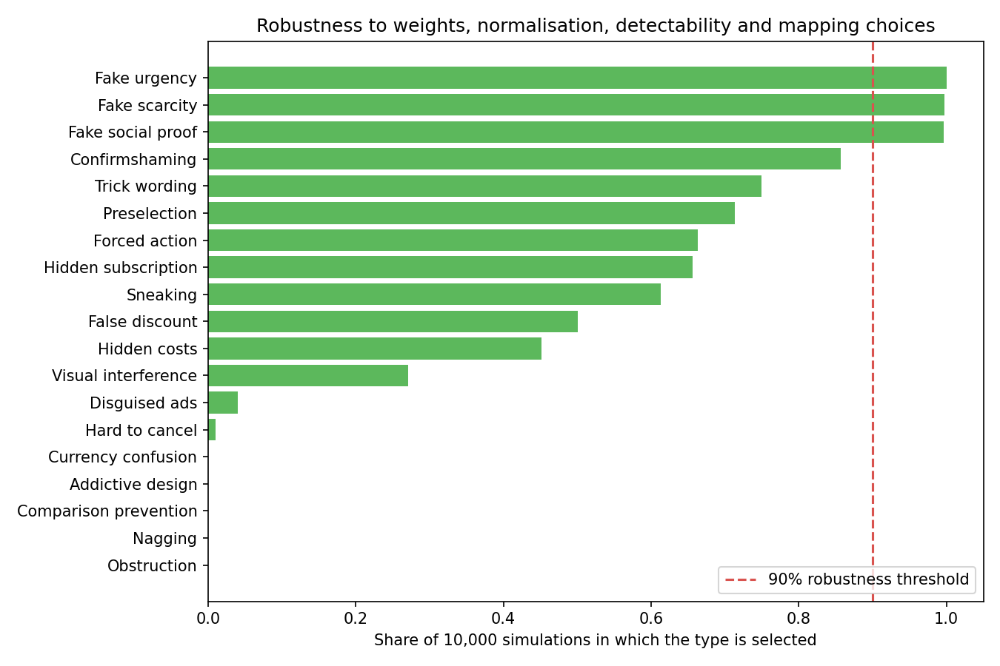

# Which dark patterns should the detector target?

This folder holds an evidence-based, reproducible answer. It ranks 19 dark-pattern types (the 18 from deceptive.design plus False discount) using published prevalence data, regulatory recognition, and whether a single-page scanner can observe each one. A sensitivity analysis checks that the result doesn't depend on arbitrary choices.

Run it with `python score_taxonomy.py`. You need Python 3 with matplotlib. It writes `results/` and `figures/`.

## Result

| Tier | Types | Why |
|---|---|---|
| **Core (robust)** | Fake scarcity, Fake urgency, Fake social proof | Selected in at least 99.6% of 10,000 simulations |
| **Core (weight-sensitive)** | Confirmshaming, Trick wording, Preselection, Hidden subscription, Forced action, Sneaking, False discount | Selected in 50–86% of simulations |
| **Extended** | Hidden costs (45%, borderline), Visual interference, Disguised ads, Comparison prevention, Currency confusion | Selected in 0–45% of simulations; detected on a best-effort basis |
| **Out of scope** | Hard to cancel (roach motel), Obstruction, Nagging, Addictive design | They need a multi-step flow or observation over time, which a single-page scanner can't see |

The baseline selects 9 types, which cover **83%** of the observable instances averaged across the four prevalence sources. False discount joins the core tier because it's selected in 50% of simulations. Across the simulations the selected set had 5–12 types (median 9), so 9–10 core types is a typical, not a lucky, outcome. For the full table see `results/ranking.csv`.





## Method

### 1. Candidate types
The candidates are the 18 types on [deceptive.design/types](https://deceptive.design/types/), which is maintained by Harry Brignull and mapped to laws and enforcement actions, plus **False discount** (inflated reference prices, such as a fake M.R.P.). False discount isn't a deceptive.design type, but the FTC lists it as "False Discount Claims", and it had the highest Pattern Vulnerability Index (25.0, with 71.4% of users unaware) in Kulkarni et al. All other sources are mapped onto these names (see the `mapping_note` and `note` columns in `data/`). Older names map like this: *roach motel* is Hard to cancel, *forced continuity* is Hidden subscription, *sneak into basket* and *add-on creep* are Sneaking, and *drip pricing* is Hidden costs.

### 2. Criteria

**Prevalence (P).** This is how often each type is observed in the real world. There are four independent sources, from different years, regions and methods:

| Source | What it measured | Sample |
|---|---|---|
| Mathur et al. 2019, *Dark Patterns at Scale* (CSCW) | Instances found by crawling shopping sites | 1,818 instances from ~11K sites ([dataset](https://github.com/aruneshmathur/dark-patterns), commit `f458f19`, counted from the raw CSV) |
| EU CPC Network sweep, 2023 | Retail websites using each pattern | 399 online shops ([press release IP/23/418](https://ec.europa.eu/commission/presscorner/detail/en/ip_23_418)) |
| ICPEN sweep, 2024 | Subscription traders using each pattern | 642 websites and apps ([public report](https://icpen.org/sites/default/files/2024-07/Public%20Report%20ICPEN%20Dark%20Patterns%20Sweep.pdf)) |
| Kulkarni et al., *Unmasking Dark Patterns* (ICTIS 2026) | Detections in a 40-participant user study on Indian sites (Flipkart, Myntra, Amazon.in and others) | 351 detections; only the categories the paper reports with counts are used |

The sources use different scales, so each one is normalised to 0–1 separately. The scores are then averaged over the sources that report the type. A type no source reports gets P = 0.

**Regulation (R).** This is how seriously regulators treat each type. It's the mean of three parts:
- the number of laws and rules on deceptive.design for the type (log-scaled)
- the number of enforcement actions on deceptive.design for the type (log-scaled)
- the share of three independent regulatory frameworks that name the type:
  - OECD *Dark Commercial Patterns* (2022): international
  - US FTC *Bringing Dark Patterns to Light*, Appendix A (2022)
  - India CCPA *Guidelines for Prevention and Regulation of Dark Patterns* (notified 30 Nov 2023, Annexure 1)

These span an international body, the Americas and Asia. deceptive.design's law counts already include EU legislation.

**Detectability (D).** This is whether this extension, which reads one page's text and DOM, can observe the type. It uses a 5-level rubric:

| D | Meaning |
|---|---|
| 1.0 | Visible in page text |
| 0.75 | Needs DOM state as well as text (e.g. checkbox state) |
| 0.5 | Needs a specific page (cart or checkout), or is only partly visible |
| 0.25 | Needs rendered visuals or comparison across pages |
| 0 | Needs a multi-step flow or observation over time |

### 3. Score

```
Score = D × (w_P · P + w_R · R)        baseline w_P = w_R = 0.5
```

D multiplies rather than adds: a type the scanner can't observe isn't a target, however common or regulated it is.

### 4. Choosing how many types (the cut-off)
Types are added in score order until they cover **at least 80% of observable instances**, averaged across the four sources. Each instance is weighted by its type's detectability, so unobservable patterns don't drive the cut-off. Averaging across sources keeps the set from overfitting to shopping sites: Mathur alone would select only scarcity, urgency and social proof.

### 5. Sensitivity analysis
There are 10,000 Monte Carlo runs (seed 42). Each run randomly varies:
- the weights, with w_P uniform on [0, 1]
- the normalisation: linear, log or rank
- every detectability level, shifted by −0.25, 0 or +0.25
- the ambiguous mapping of Mathur's "Pressured Selling", to Preselection or to Visual interference

A type is **robust** if it's selected in at least 90% of runs.

## Findings worth noting
- **The detector can find the presence of urgency, scarcity and social proof, but not whether they are fake.** In Mathur's data, only 157 of 393 countdown timers and 17 of 632 low-stock messages were *verifiably* false. The extension should say "pressure tactic detected", not "this is fake", unless it has proof (for example, a timer that resets).
- **Visual interference is highly prevalent but scores low only because of detectability (0.25).** It's the second most common type in both regulatory sweeps. If the extension starts reading computed styles (contrast, size, prominence), its D rises and it would join the core set. This is the most valuable detection upgrade.
- **Hard to cancel (roach motel) is the most regulated type that's out of scope** (46 laws, 23 enforcements). The extension still recognises it when cancellation obstacles are visible on the scanned page, but detection isn't claimed to be reliable. A future multi-step "cancellation flow" mode would address it.
- **False discount's regulation score (0.11) is understated.** deceptive.design doesn't track it as a type, so it gets 0 laws there, although EU price-indication rules on prior-price claims regulate it directly. A better source of law counts for it would raise its score.

## Limitations
- The sources have different denominators: instances (Mathur), sites (EU) and traders within sub-populations (ICPEN). That's why each source is normalised separately rather than pooled.
- The ICPEN sweep covers subscription services only, the EU sweep checked only three categories, and Kulkarni et al. used a convenience sample of students and LLM-assigned labels. Absence from a source is treated as "not measured", not "not prevalent".
- The EU Commission's 2022 behavioural study (97% of popular sites and apps had at least one dark pattern) ranks hidden information, false hierarchy, preselection, nagging, difficult cancellation and forced registration as most common. Its per-type table wasn't machine-readable, so it isn't in the score. Adding it is a good next step.
- The EU Digital Services Act, Article 25, should be added as a fourth framework once its text has been checked against EUR-Lex by hand.
- The detectability levels are the project team's judgement. The sensitivity analysis shows the core set holds when every level shifts by ±0.25.
- The Pattern Vulnerability Index (PVI) from Kulkarni et al. could be added as a harm criterion, `Score = D × (w_P P + w_R R + w_H PVI)`, once PVI values exist for all types. The paper reports them only for Discount anchoring (25.0), Urgency (19.0) and Costs (15.0).
